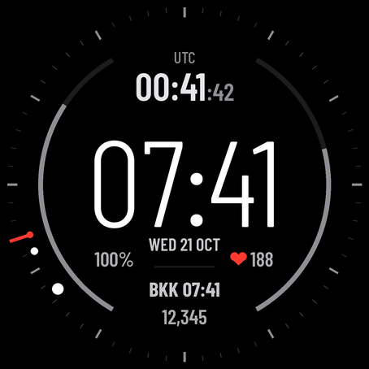

# Pilot Zulu — Garmin watch face for pilots

A minimal, high-contrast Connect IQ watch face for the **Garmin Forerunner 965** (454×454 AMOLED), designed by an airline pilot for life across time zones.

## Features

- **UTC (Zulu) time** with seconds at the top
- **Large local time** in the centre, date below
- **Home-base time** (`BKK`, UTC+7) on its own row
- Watch battery %, heart rate (red heart) and steps
- **Rim:** 60-minute track, cream hour dot + minute dot, red seconds stub (no hands over the digits)
- **Side gauges** (7–11 and 1–5 o'clock), each selectable: Body Battery · Watch battery · Step goal · **Off**
- **Themes:** Vintage cream · Night (dim) · Mono — all with a red accent
- AMOLED-friendly always-on mode: dim, no seconds, burn-in shift every minute

Settings can be changed on the watch (long-press the face → Watch Face → Pilot Zulu → Customize) or in the Connect IQ phone app.

> Note: on AMOLED watches seconds only update for ~10 s after a wrist raise; that's a Garmin platform limit.

## Build & install (sideload)

1. Install VS Code + the **Monkey C** extension, then `Monkey C: Verify Installation` → SDK Manager → download the SDK and the **fr965** device.
2. `Monkey C: Generate a Developer Key`.
3. Open this folder, run `Monkey C: Build for Device` → fr965. You get `PilotZulu.prg`.
4. Connect the watch (macOS: use [OpenMTP](https://openmtp.ganeshrvel.com/), quit Garmin Express) and copy the `.prg` into `GARMIN/APPS`.

## Customising

- **Home city / offset:** `HOME_LABEL` and `HOME_UTC_OFFSET_SEC` in `source/PilotZuluView.mc` (the `Home`/`Row` fonts only contain the letters `B` and `K` — add glyphs in `tools/make_fonts.py` if you change the label).
- **Fonts** are pre-rendered bitmap fonts from Barlow Condensed. Regenerate with `python3 tools/make_fonts.py` (needs Pillow and the TTFs in `./fonts`).
- Layout coordinates are in a 454-px design space, scaled by `s = width / 454`.

## Other devices

Only `fr965` is listed in `manifest.xml`. Other round AMOLED devices should work by adding them to the manifest, but are untested.

## License

Code: [MIT](LICENSE). Bitmap fonts are derived from **Barlow Condensed** by The Barlow Project Authors, licensed under the [SIL Open Font License 1.1](resources/fonts/OFL-Barlow.txt).
